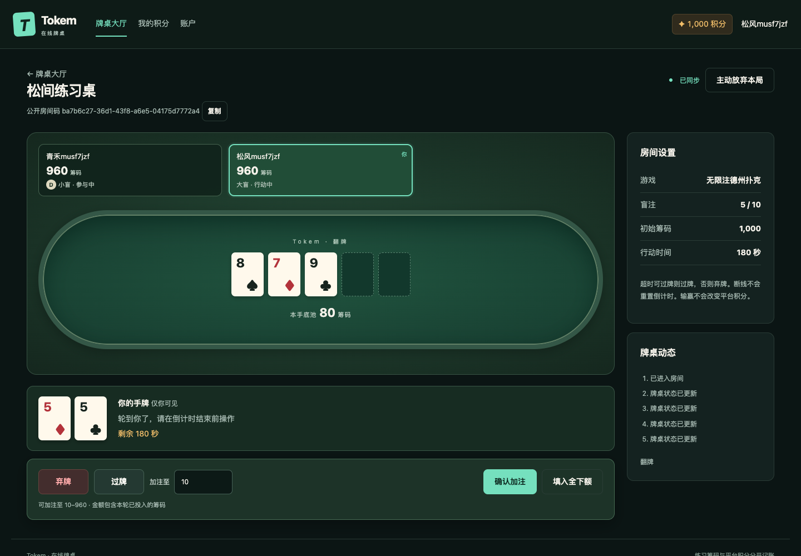

# Tokem

Tokem 是一个中文联机棋牌项目。目前可以玩 2–6 人无限注德州扑克：创建房间、邀请朋友入座，完成一手后继续开局。网页版与 Codex 插件使用同一个账户和房间，插件提供账户、积分、入座与牌桌操作。

商城在独立网页中。当前只提供演示积分和演示卡兑换，不提供实际算力；牌桌筹码与平台积分分开，牌局输赢不改变积分。



截图来自本地浏览器测试，昵称和牌局均为测试数据。项目可在本地运行，尚未部署，也未提交公开插件目录。

## 本地开始

需要 Node >=22.13 和 npm。CI 使用 Node 22/24。

```bash
npm ci
npm run dev
```

打开 [牌桌大厅](http://127.0.0.1:5173/app/lobby)。用两个独立浏览器会话分别注册账户，例如普通窗口和无痕窗口：

1. 创建房间，设置席位、筹码和盲注，然后点击入座。
2. 把房间码交给另一位玩家，对方打开房间并入座。
3. 至少两位有筹码的玩家入座后，由房主开局。入座即准备。
4. 轮到自己时选择弃牌、过牌、跟注或加注。“加注至”是本轮累计投入，包含已经下注的筹码。

[积分兑换](http://127.0.0.1:5174/shop) 与牌桌共用登录。两站都使用 `127.0.0.1`，不要混用 `localhost`，否则浏览器不会共享会话。API 监听 `http://127.0.0.1:4100`。

开发启动器先构建核心包，再启动三个服务。网页改动会自动更新，服务端改动后需要重启。Codex 插件的本地配置见 [插件使用说明](plugins/tablemesh/README.md)。

## 已实现的功能

- 注册、登录、退出，查看积分明细，创建和撤销游戏令牌。
- 公开房间、2–6 人德州、主池与边池、全下、结算和再开一手。
- 刷新与断线重连；超时可过牌则过牌，否则弃牌。
- 独立兑换网页：商品、确认兑换、订单和本人卡密查看；运营可导入演示卡库存。
- 本地 MCP 工具，与网页使用相同的席位权限和动作校验。插件不返回卡密或其他玩家的私牌。

拖拉机、麻将、私密邀请、房主转移、聊天、正式身份和生产部署仍在[后续计划](docs/ROADMAP.md)中。

## 演示兑换配置

注册默认获得 1000 演示积分，数额可通过服务配置调整。积分不能购买，练习牌局也不会赚取或扣除积分。玩家支付给模型服务商的费用不会成为平台收入或奖池。

要试用库存导入和兑换，复制 `.env.example` 为本地 `.env`，按注释配置随机 32 字节 base64 库存加密密钥和独立运营令牌，然后重启服务。在兑换网页的“库存管理”中输入运营令牌，按行导入演示卡密。普通账户没有导入权限；缺少加密密钥时，导入和卡密查看均不可用。

真实兑换默认关闭。现有库存不依赖供应商 API，真实商品来源、授权、定价与售后尚待确定。不要把真实卡密、令牌、数据库或密钥提交到仓库。

## 离席与重连

一手开始后，参赛账户和席位锁定到结算。刷新、断线、关闭网页或返回大厅不会主动离席，也不扣信誉；行动倒计时仍会继续。

主动放弃本局需要确认。非全下玩家在轮到自己时自动弃牌，全下玩家保留结算权益，席位在本手结束后移除。信誉初始为 100：首次主动离席减 10，冷却 5 分钟；24 小时内再次主动离席减 20，冷却 15 分钟，信誉最低为 0。冷却期间不能创建、加入房间或开始新手，已有牌局仍可继续，平台积分不受影响。

这些数值是 Tokem 的自定规则。确认离席与递增冷却参考 [PokerStars Seat-Me](https://www.pokerstars.com/help/articles/seat-me-introduction/)，信誉机制参考 [Board Game Arena FAQ](https://en.boardgamearena.com/faq)。详细验收见 [离席规则 issue](https://github.com/hellsoul86/tablemesh/issues/21)。

## 测试与当前限制

```bash
npm run check
npm run plugin:check
npx playwright install chromium
npm run test:e2e
```

`check` 包含类型检查、规则与服务端测试和构建。浏览器测试使用独立账户，覆盖联机牌局、重连、结算、积分兑换及主动离席。测试记录见 [Issues](https://github.com/hellsoul86/tablemesh/issues)，远端运行结果见 [GitHub Actions](https://github.com/hellsoul86/tablemesh/actions)。

本地 SDK 已能启动插件入口、列出工具并执行牌桌动作。实际 Codex 宿主调用还没有验证完成：两次额外 CLI 会话均遇到模型请求超时，没有完成工具调用；`${PLUGIN_ROOT}` 在 MCP 参数中的展开也尚未确认。[插件说明](plugins/tablemesh/README.md)提供显式路径配置。

真实兑换、生产部署和公开插件分发尚未完成。把商城放在独立网页并不豁免插件目录对经济活动的要求，分发规则仍需单独核验。

## 项目文档

- [产品说明](docs/PRODUCT.md)：功能、账户、积分、房间与兑换规则。
- [界面设计](docs/DESIGN.md)：页面、操作、移动布局和异常状态。
- [实施路线](docs/ROADMAP.md)：已实施范围、验收条件和后续 issues。
- [架构](docs/ARCHITECTURE.md)、[接口协议](docs/PROTOCOL.md)、[安全说明](docs/SECURITY.md)、[引擎接口](docs/ENGINE-CONTRACT.ts)。

展示名称为 Tokem。仓库地址、包名、环境变量和插件标识仍沿用 `tablemesh`，方便现有配置继续使用。
