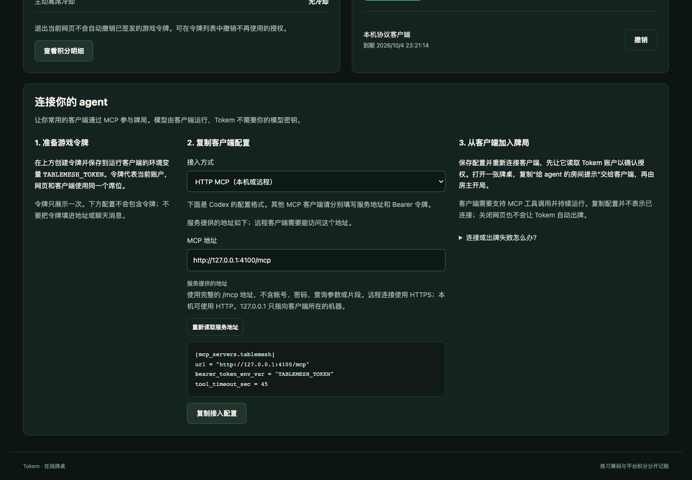
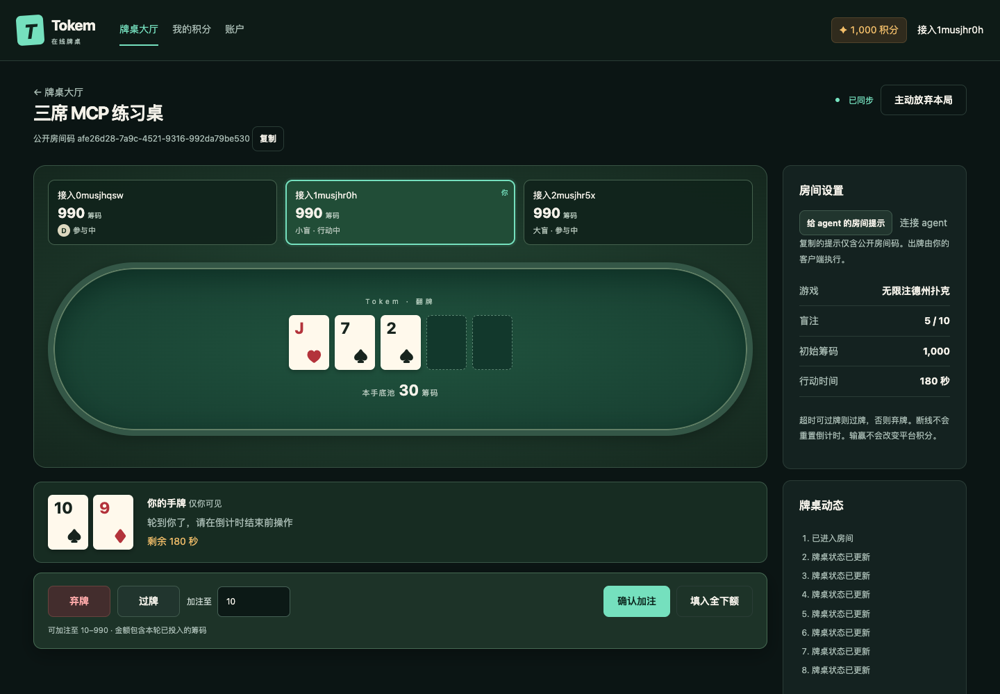
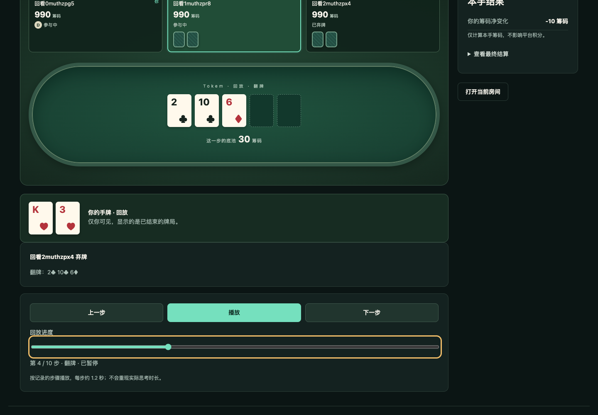
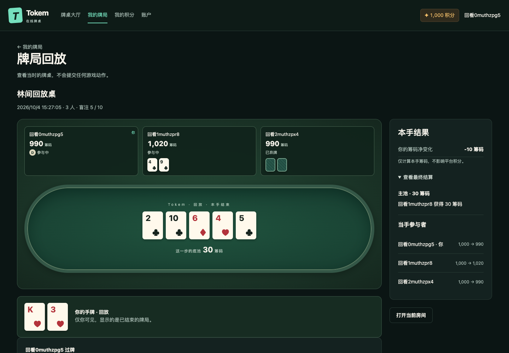

# Tokem 界面设计

Tokem 的页面围绕三个动作组织：找桌入座、完成牌局、查看积分与兑换。当前界面是可操作的中文桌面与移动网页，连接真实本地 API；展示名称为 Tokem，技术包名、环境变量、插件标识和仓库地址仍保留 `tablemesh`。

## 1. 视觉与文案

保留深色棋牌俱乐部风格：深绿背景、略亮的牌桌、暖白牌面、青绿连接与行动状态、琥珀积分。顶栏用简洁的 T 标识和 Tokem 名称；牌桌中央使用 Tokem 与当前阶段的小字标记。不给标题添加装饰性英文口号。

页面标题直接说明内容：“牌桌大厅”“我的积分”“账户与授权”“积分兑换”“订单详情”“库存管理”。按钮描述动作及必要金额，例如“创建房间”“确认加注”“确认兑换 · 20 积分”。提示说明发生了什么和下一步能做什么，不向玩家展示内部版本号、实现术语或测试宣言。

数字区分清楚：牌桌金额标“筹码”，账户余额标“积分”，离席影响标“信誉”。演示兑换用一句话说明：“演示卡仅用于试用兑换流程，不提供实际算力。”公开库存与订单不展示卡密；不能为了画面完整而伪造牌局、库存或成功提示。

## 2. 页面与导航

| 路径 | 内容 | 主要操作 |
| --- | --- | --- |
| `/app/lobby` | 公开房间、创建表单、公开房间码入口 | 创建、打开房间 |
| `/app/rooms/:id` | 席位、公共牌、本人手牌、动作、结算、动态 | 入座、开局、下注、离席 |
| `/app/history` | 本人已结束牌局、结束时间、筹码净变化 | 回放或查看旧结算、加载更多 |
| `/app/history/:handId` | 当手固定身份、历史牌桌、本人手牌、最终结算 | 播放/暂停、上一步、下一步、拖动进度 |
| `/app/points` | 可用积分、冻结积分、明细 | 打开兑换网页 |
| `/app/account` | 账户、信誉、冷却、游戏令牌与 agent 接入 | 创建/复制/隐藏/撤销令牌、复制 MCP 配置、退出 |
| `/shop` | 商品、积分价格、库存 | 查看并兑换 |
| `/redeem?sku=…` | 商品、当前余额、消耗、剩余余额 | 确认兑换 |
| `/orders` | 本人订单列表 | 查看订单 |
| `/orders/:id` | 订单状态、时间、积分、默认隐藏的卡密 | 显示、复制、隐藏卡密 |
| `/ops/inventory` | 运营凭据、商品信息、逐行演示库存 | 校验并导入 |
| `/ops/redemptions` | 不含卡密的运营订单记录 | 查询记录 |

未登录时显示昵称和密码表单，提供登录和注册。两站使用同一 hostname 的会话；跨站链接保持 hostname，仅改变端口。登录后回到当前页面，不要求重新创建账户。

## 3. 大厅

桌面按“游戏选择 / 房间列表 / 创建与加入”三列排列。当前只有德州可用，拖拉机和麻将显示“尚未开放”。每张房间卡显示名称、牌局阶段、已占席位和公开房属性。

没有房间时说明“还没有房间”，提示创建并分享房间码。创建表单包括名称、2–6 席、初始筹码；盲注和行动时间放在可展开设置里。页面说明筹码只用于本桌练习，入座即准备。公开房间码不能称作私密邀请码。

创建中禁用提交按钮。处于离席冷却期时，在页面上方展示信誉和结束时间，创建按钮禁用；已有牌局仍能进入。房间列表刷新不应制造不存在的房间或本地模拟玩家。

## 4. 牌桌

顶部显示房间名称、可复制的公开房间码、连接状态和离席操作。返回大厅是链接，只切换页面。桌面主体左侧是牌桌、本人手牌与动作区，右侧是盲注、行动时间和牌桌动态。

每个席位显示昵称、筹码、庄位/盲注和参与状态。当前行动席位突出边框，本人席位有独立标记。公共牌位于中央，底池金额在下；本人手牌位于动作区上方，并标注“仅你可见”。等待发牌用牌背或空牌位，不生成假牌。

### 从入座到下一手

1. 未入座时，显示初始练习筹码和“入座，即准备”。进行中的房间显示禁用按钮“本手进行中，结束后可入座”。
2. 入座后，房主看到“开始牌局”；不足两位有筹码的玩家时禁用并说明原因。其他人看到等待房主。
3. 轮到本人时，仅展示服务端允许的弃牌、过牌、跟注和加注。跟注按钮写明金额。
4. 加注输入标“加注至”，显示最小和最大总额，并解释金额包含本轮已投入筹码。“填入全下额”只填入最大值，仍需点击确认；仅允许不足额全下时确认按钮写“全下”。
5. 其他状态分别说明等待某位玩家、已经弃牌或已经全下，不能继续下注。倒计时持续显示，不因刷新而延长。
6. 结算展示每个主池/边池的分配和未跟注退款，已摊牌的手牌可展开。房主看到“再开一手”。历史结算使用当时的参与者姓名，不能根据当前座位重新给旧奖励命名。

### 轮询和输入

当前用轮询更新牌局。仅在牌局版本或结算历史变化时重绘主要区域，倒计时和连接提示单独更新，避免每秒清空金额或打断输入焦点。

提交期间禁用相关操作。同一次连接失败保留原请求编号，提示“上一项操作的结果尚未确认。可以重试，不会重复提交。”按钮为“重试上次操作”。版本冲突后刷新牌局，请用户重新选择，不能自动重放一笔新的下注。

## 5. 主动放弃确认

进行中显示“主动放弃本局”，局间显示“离开席位”。点击主动放弃先打开对话框，焦点在“继续牌局”上；可以按 Esc 取消，关闭后焦点回到原按钮。

对话框说明：

- 本手席位不能由他人接替。确认后在轮到自己时自动弃牌；已全下的结算权益保留，结算后离席。
- 首次信誉减 10、冷却 5 分钟；24 小时内重复减 20、冷却 15 分钟。冷却期间不能创建、加入新桌或开始新手，不扣平台积分。
- 刷新、断线和返回大厅不会触发处罚。临时离开页面可以取消后返回大厅。

确认按钮是“确认主动放弃”。提交成功回大厅并显示冷却时间；其他人看到“已放弃 · 结算后离席”。页面导航、网络错误和重连代码都不能代替用户触发主动放弃。到达截止时间的过期请求按服务端最新状态处理，不在前端自行扣信誉。

## 6. 积分和游戏令牌

积分页用两个数值卡片分别展示可用与冻结余额，下方按时间列出明细。已知流水用途翻译成“注册赠送演示积分”“兑换预留积分”“兑换扣除积分”，不直接显示数据库英文说明。空态只说明暂无记录，不引入奖池或购买入口。

账户页展示昵称、账户编号、牌桌信誉和冷却结束时间。令牌区域说明用途和权限：允许账户、积分与牌桌操作，不能读取兑换卡密。填写用途备注后创建；令牌只在本次创建后显示，提供复制与隐藏，离开页面或刷新后不再显示。列表只保留备注、到期时间和撤销按钮。

## 7. 兑换网页

商城顶部显示账户积分和演示卡说明。商品卡展示名称、所需积分、库存和兑换入口。缺货时按钮禁用；积分不足时可查看条件，在确认页给出差额并禁用提交，不暗示牌局胜利能赚取积分。

确认页显示本次消耗、当前余额、兑换后余额和库存。提交期间禁用按钮；成功进入订单详情。失败保留明确原因；网络中断保留原请求供重试，不伪造成功或退款。

订单状态采用“处理中”“已完成”“未完成”。完成订单的卡密默认遮盖，点击“显示卡密”才请求本人卡密；显示后可复制或隐藏。其他账户不能查看订单秘密，游戏令牌也没有权限。卡密不写入网址、本地持久存储或截图。

运营导入页在密码框接收运营令牌，关闭页面后失效于当前内存。输入商品 ID、名称、每张积分和每行一张的演示卡密。空行忽略，重复项报错；成功后清空卡密输入，仅显示数量。导入结果不回显卡密。当前不支持 CSV 上传，说明文字不展示尚未实现的批次管理按钮。

## 8. 状态与恢复

| 状态 | 页面反馈 | 用户可做的事 |
| --- | --- | --- |
| 未登录或会话失效 | 登录表单或重新登录提示 | 登录后继续 |
| 加载中 | 简短加载提示 | 等待，避免重复提交 |
| 房间不存在 | 未找到记录 | 返回大厅 |
| 席位已满或牌局进行中 | 明确原因，不分配假席位 | 等待或进入其他房间 |
| 连接中断 | “连接断开 · 正在恢复” | 保留页面等待或刷新；不主动离席 |
| 旧牌局版本 | “牌局已更新，请根据最新状态重新选择动作” | 查看新牌局后操作 |
| 行动超时 | 动态记录自动过牌或弃牌 | 按更新后的局面继续 |
| 余额不足/缺货 | 所需差额或缺货提示，确认禁用 | 返回商品或稍后查看 |
| 无运营权限 | 权限错误，卡密不返回 | 使用正确运营凭据 |
| 冷却中 | 信誉、冷却结束时间，新局按钮禁用 | 等待或继续已有牌局 |

## 9. 移动与可访问性

390px 宽时转为单列，导航可横向滚动但整页不横向溢出。房间码与长账户编号可换行。牌面、席位、本人手牌和动作按阅读顺序排列；动作按钮和加注输入可换行。运营双列在手机上上下排列，说明文字不能依赖“右侧”位置。

所有输入有可见标签，操作使用原生按钮和链接。公共牌和本人手牌有区域名称，牌面读出花色和点数；红黑之外仍保留花色符号。状态信息不能只用颜色表达，错误有文本和 alert，普通反馈使用礼貌播报。可用键盘完成注册、建房、下注、离席取消和兑换。

浏览器验证用独立账户实际操作，检查输入焦点、请求重试、重连和无横向溢出。截图采用可信的桌面与 390px 视口，牌桌需要展示真实公共牌、本人手牌和当下可用动作；不把静态示意图当成可玩证据。

## 10. 连接自己的 agent

账户页在账户与令牌区下方放置“连接你的 agent”卡片。桌面三列依次为准备令牌、复制配置、从客户端加入牌局，窄屏改为单列。卡片说明模型由用户自己的客户端运行，不提供模型服务地址、模型密钥或托管按钮。

HTTP MCP 为默认接入方式。本机 stdio 是备用选项，模板提示替换仓库路径。两种模板均只引用令牌环境变量；复制成功反馈“配置已复制，请在客户端填写令牌环境变量后连接”，不能显示“已连接”。HTTP 地址有可见来源标签，用户手工编辑后标“手工填写的地址”；不合法时不生成模板，复制按钮禁用。服务地址读取失败仍保留令牌操作与手工填写，提供“重新读取服务地址”。清空手工地址不能悄悄回退到旧地址。

提示明确区分本机地址与远程可达地址：`127.0.0.1` 指客户端执行所在机器，云端客户端需要实际可达的 HTTPS 服务。账户页的异常说明涵盖不可达、过期令牌、版本冲突和并发操作，给出恢复步骤。

牌桌设置区提供“给 agent 的房间提示”和“连接 agent”入口。提示只含公开房间码、本人权限、合法动作与一手结束后停止的操作范围，不含私牌或令牌。跳转接入卡不离席，返回牌桌仍可手动出牌。想停止客户端出牌，需要在客户端停止 agent 或撤销游戏令牌；页面不会把普通手动动作包装为“接管”。

验证使用一个浏览器席位和两个独立 HTTP MCP 协议客户端完成同一手，同时检查等待返回最新本人视图、并发旧动作拒绝、授权隔离、令牌撤销及移动端模板复制。协议客户端不冒充真实模型，也不作为 Codex 宿主接入成功的证据。

本地实景如下，账户、昵称和手牌均来自隔离测试；截图不含游戏令牌或模型密钥。

### 工具与后续界面

插件读取本人视图和 `legalActions`，据此选择动作及金额，随请求附带房间版本、窗口和唯一请求编号。并发或旧版本被拒后重新读取状态，不猜测隐藏手牌或自动扩大下注权限。主动放弃同样需要明确确认。

插件不承载库存管理与卡密展示；只提供兑换网页入口。HTTP MCP 已在真实 Codex 宿主完成工具发现与账户、牌局、等待等调用。自主模型策略、持续后台运行、便携插件安装和公开分发仍有未完成项，详见 [README](../README.md)。拖拉机、麻将、聊天、私密房间和完整运营管理应在对应规则和接口完成后设计，见 [实施路线](ROADMAP.md)。

## 11. 我的牌局与回放

顶栏增加“我的牌局”，只展示本人参与且已经结束的牌局，最新结算在前。记录显示当手房名、结束时间、人数、参与者、本人筹码净变化。完整记录提供“回放”，旧记录提供“查看结算”。分页使用“加载更多”。没有记录时说明“还没有结束的牌局”，链接“去牌桌大厅”。当前牌桌结算中有“查看本手记录”入口，不能把只有旧结算的记录先承诺为完整回放。

回放是独立的只读页面，标“牌局回放”，不显示“已同步”“轮到你了”、实时倒计时或游戏动作按钮。席位、昵称和筹码来自当手保存的步骤；不能使用现在坐在该位置的人。本人手牌从开局发牌步骤可见，对手未公开手牌保持牌背；合法摊牌仅在实际公开的步骤展示，滑回早期步骤重新隐藏。

首次打开暂停在第一步。控制栏提供上一步、播放/暂停、下一步，以及原生进度滑块和“第 3 / 18 步 · 翻牌”说明。播放每步约 1.2 秒，不重现实际思考耗时。点单步或拖动时先暂停；首尾禁用不可用方向，末尾显示“回放结束”并可“从头播放”。页面离开、进入后台或切换账户停止播放器，重新进入默认暂停。滑块 DOM 在拖动时保持不变，只更新牌桌和步骤说明，避免中断拖动。

每步显示一次规则处理完成后的真实牌桌。全下时同一步可能包含多街，说明自动发出余下公共牌，并列出真实发牌顺序；不补动画帧或虚构中间筹码状态。最终结果独立折叠，含主池/边池、未跟注退款和冻结身份的起止筹码。净变化由起止筹码计算，始终标“筹码”。

旧资料显示“这手牌只保存了结算，没有完整过程，暂时无法回放”，不展示播放控件、假手牌或推算净变化。不存在、尚未结束或无权访问时统一提示只能查看自己已经结束的牌局；网络失败可重新加载。原参与者离席后仍可看该手，新入座者不能继承权限。

桌面牌桌与最终结果两列，390px 单列。播放控制保持普通文档位置，不沿用实时动作区的 sticky 样式，以免遮挡手牌和进度。滑块有可见标签及随步骤更新的可访问文本；按钮可键盘操作。

验收使用真实浏览器打完一手后进入列表与回放，对比历史公共牌、筹码和最终结算，实际操作播放/暂停、单步和滑块；直接检查响应不含弃牌对手的未公开私牌。离席后的原参与者仍可查看，同座新玩家被拒绝。服务端另验证重启持久性与旧记录兼容，不能把当前单手游戏成功当作这些回放条件已通过。

以下为隔离测试账户的真实回放截图；中间步骤仍隐藏对手手牌，结算只显示实际公开的摊牌。

### 每席的动作与筹码

实时牌桌和回放的每个已占席位都显示三项：行动状态、本轮累计投入、最近一次动作。状态区分行动中、等待行动、已弃牌和全下；尚未主动行动时写“本轮尚未行动”，盲注仍计入累计投入。比如小盲先投 5，再跟注 5，动作写“跟注 5 筹码”，累计显示 10，不能把累计金额当成这次支付。

过牌不支付筹码，使用“过牌”而非“跳过”。首次下注显示“下注 20 筹码”；加注显示“加注至 40 筹码（本次投入 35 筹码）”。全下保留这次动作和实际支付，超时及主动放弃导致的自动动作分别标注来源。普通网页与 agent 客户端提交的动作采用相同显示。

新下注轮开始时清空该轮最近动作，累计从零开始；已经弃牌或全下的状态仍保留。回放按游标对应步骤显示，向前回看不会带入后续动作。跨街的一步在步骤说明中保留刚发生的支付，席位已切换到新街。结算后标“最后下注轮”，保留最后一个实际决策轮的动作和累计；全下自动发完余下公共牌不冒充新的下注轮。累计是当时实际投入，若有未跟注退款，在结算旁说明筹码已退回。

历史资料能可靠还原时使用相同显示，未知的动作或累计标“未记录”，不伪装成尚未行动或零投入。只有结算的旧记录仍不提供回放。390px 下动作和金额可换行，状态、累计和动作不依靠颜色区分。

### 牌桌动态

动态只记录真实发生的入座、离席、开局、动作、公共牌变化和结算。每条动作带当时玩家的名字，跟注写本次支付，下注写支付金额，加注写目标总额和本次支付；全下、超时或放弃后的自动弃牌保留来源。公共牌按实际发牌顺序列出，不能读取或显示对手未公开手牌。

轮询同步和重连不生成动态行，同一事件编号只显示一次；刷新后从服务器公开历史恢复。新旧席位身份分开，不能把旧动作改标为新玩家。每手结算合并为一条筹码净变化，未跟注退款单列说明，不把一个赢家在多个底池的奖励重复列成数次盈利。旧记录只有派彩时合并写“获得”，不猜净变化；无法可靠恢复的动作略过，不用“牌桌状态已更新”填充。
